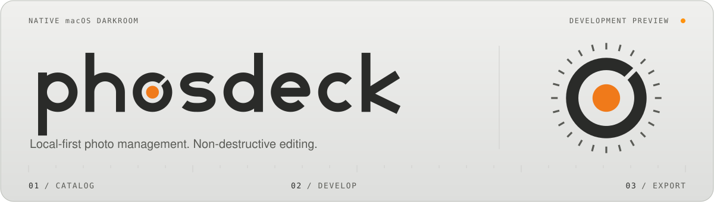

<picture>
  <source media="(prefers-color-scheme: dark)" srcset="docs/assets/readme/hero-graphite.svg">
  <source media="(prefers-color-scheme: light)" srcset="docs/assets/readme/hero-ivory.svg">
  
</picture>

<h1 align="center">Phosdeck · 照片在本地，暗房在手边。</h1>

<p align="center">
  为 macOS 打造的照片管理与非破坏性编辑工具。<br>
  从选片、编辑到成片交付，留在同一间暗房。
</p>

<p align="center">
  <a href="#快速上手"></a>
  <a href="#开发与贡献"></a>
  <a href="#当前范围"></a>
  <a href="LICENSE"></a>
</p>

<p align="center">
  <a href="#一眼看见">界面预览</a> ·
  <a href="#从导入到成片">功能</a> ·
  <a href="#快速上手">源码构建</a> ·
  <a href="#当前范围">当前范围</a> ·
  <a href="docs/README.md">文档</a> ·
  <a href="#启发与致谢">启发与致谢</a> ·
  <a href="#许可">许可</a>
</p>

> **开发预览**：目前通过源码构建体验。功能仍在验证与迭代中，已知边界见下方“当前范围”。

## 一眼看见

<picture>
  <source media="(prefers-color-scheme: dark)" srcset="design/darkroom_workspace_graphite.jpg">
  <source media="(prefers-color-scheme: light)" srcset="design/darkroom_workspace_ivory.jpg">
  
</picture>

<p align="center"><sub>米白与石墨两种主题，随 GitHub 明暗外观展示。以上为 2026-11-03 的合成数据实窗截图，未经拼接。</sub></p>

界面沿用实体按键、水平推子与橙色指示灯。照片及观片底保持中性，主题不会改变照片像素或导出结果。

## 从导入到成片

| 整理照片 | 照片编辑 |
|---|---|
| **找到值得留下的那一张。**<br>引用或复制导入，评级与标旗，关键词、普通／智能集合，虚拟副本、堆叠及 RAW/JPEG 关联。 | **调整保留在配方里。**<br>曝光与白平衡、自由点曲线、HSL、黑白混色、点颜色、颗粒与暗角，结合预设、历史和快照。 |
| **局部处理**<br>画笔、渐变、颜色／亮度范围蒙版，局部调整与污点修复；裁剪、拉直、翻转及手动透视校正。 | **交付成片**<br>JPEG、PNG、TIFF16，命名模板、导出预设与多规格输出，按选项写入元数据，并检查同名冲突。 |

功能实现、实际验证与用户验收分别记录，详见 [功能清单](docs/lightcraft_reference_checklist.md)。XMP 预设子集导入只做近似参数转换，不承诺 Lightroom 画质等价。

## 快速上手

需要 **macOS 26 或更新版本、Xcode 26 或更新版本（含 Metal Toolchain）**。当前主要在 Apple Silicon 上验证。

1. 获取源码（仓库未公开时需要读取权限）：

   ```sh
   git clone https://github.com/rankangkang/phosdeck.git phosdeck
   cd phosdeck
   ```

2. 在仓库根目录构建：

   ```sh
   xcodebuild -project Phosdeck.xcodeproj -scheme Phosdeck -configuration Debug -derivedDataPath build -destination 'platform=macOS' build
   ```

首次构建需要联网，Xcode 会下载项目锁定的 Swift 包和二进制依赖。默认 Debug 构建使用本机临时签名，不需要 Apple 开发证书或开发团队；也可以在 Xcode 中打开 `Phosdeck.xcodeproj`，选择 `Phosdeck` scheme 并运行。临时签名仅用于本机开发：实测 Xcode 27.1 会关闭该产物的 hardened runtime；沙箱与文件访问权限设置仍保留。

构建产物位于 `build/Build/Products/Debug/Phosdeck.app`，供本机开发体验。首次体验建议新建测试目录，导入少量合成或有权使用的照片，再完成评级、调整与导出。目录保存照片位置和调整，原片保留在照片文件夹中。完整步骤和备份恢复的边界见[上手指南](docs/getting-started.md)。

Phosdeck 新建图库使用 `.phoscat`。现有 `.omlcat`／`.omlrcat` 仍可打开：打开时可确认更换后缀、保持原名打开或取消；更换后缀仅在原位置无覆盖改名，数据库内容保持不变。沿用现有 bundle ID `dev.cmkk.oh-my-lrc` 和 Application Support 中的 `OhMyLRC` 数据目录，保留现有设置、文件授权和图库位置。

<details>
<summary>需要稳定的本机开发签名？</summary>

[临时签名](https://developer.apple.com/documentation/technotes/tn3127-inside-code-signing-requirements)在重新构建后可能需要重新授予文件访问权限。如已安装 Apple Development 证书，可新建 `Config/LocalSigning.xcconfig`，填写自己的团队 ID：

```xcconfig
CODE_SIGN_IDENTITY = Apple Development
DEVELOPMENT_TEAM = 你的团队ID
```

该文件已被 Git 忽略，会覆盖 Debug 的默认签名设置；不需要稳定签名时无需创建。证书须已安装在本机钥匙串。发行签名和公证不在此构建流程范围内。

</details>

<details>
<summary>缺少 Metal Toolchain？</summary>

若 Xcode 报缺少该组件，可执行：

```sh
xcodebuild -downloadComponent MetalToolchain
```

</details>

## 当前范围

| 项目 | 当前状态 |
|---|---|
| 输入 | JPEG、RGB 单页 TIFF、支持范围内的静态 PNG；ARW／NEF／CR3／RAF／部分 DNG 的实际可用性取决于机型、压缩方式与 macOS 解码能力。 |
| 暂未开放 | HEIC、Apple DNG／ProRAW；不由已验证样片推断所有相机或压缩模式均可用。 |
| 输出 | JPEG、PNG8、TIFF16；当前固定为 sRGB，广色域与软打样尚未实现。 |
| 智能蒙版 | 整个人物选择使用系统 Vision，默认源码构建即可用；对象与部位识别需要另行准备的研究权重，默认构建不含。手动蒙版和已保存选区的渲染不依赖权重。SAM／Selfie 有 Apache-2.0 依据，人脸权重分发授权仍待核实，见[模型与可用状态](docs/smart-mask-models.md)。 |
| 目录格式 | 开发阶段不保证旧版本目录兼容，不做旧 schema 迁移；升级前保留现有目录、备份与原片。 |
| 界面语言 | 官方维护简体中文和英文，支持社区语言包；英文界面仍有部分截断和文案问题，见[国际化说明](docs/localization.md)。 |

## 开发与贡献

在仓库根目录运行原生检查：

```sh
./scripts/check.sh
```

检查会调用 `python3` 和其标准库准备可选的公开 RAW 测试素材，无需额外的 Python 包。部分 RAW 或特定环境测试会在缺少样片或授权条件时跳过，以每轮实际结果为准。

| 入口 | 内容 |
|---|---|
| [上手指南](docs/getting-started.md) | 创建图库、导入、编辑、导出及备份恢复 |
| [贡献与反馈](CONTRIBUTING.md) | 反馈问题、隐私保护、开发检查和提交说明 |
| [开发约定](AGENTS.md) | 代码导航、数据保护、提交规范与本机体验流程 |
| [开源准备待办](TODO.md) | 待确认的公开内容和后续事项 |
| [文档索引](docs/README.md) | 现行文档与当前进展 |
| [设计规范 v3](design/darkroom_instrument_design_system_v3.md) | 原生暗房仪表外观与交互约定 |
| [设计 Token v3](design/darkroom_instrument_tokens_v3.json) | 米白／石墨配色、尺寸与状态 Token |
| [README 视觉素材](docs/assets/readme/README.md) | SVG 封面、截图来源与制作方式 |
| [问题与建议](https://github.com/rankangkang/phosdeck/issues) | 提交复现步骤、运行环境或功能建议 |

<details>
<summary>维护者的固定体验 App 与测试素材说明</summary>

开发与流程体验固定复用 `build/unrated-stars-review/oh my lrc Star Review.app`，具体构建、签名与更新规则见 [AGENTS.md](AGENTS.md)。测试仅使用合成数据、`Samples/public-cc0/` 或已授权只读的 `Samples/PublicRAW/`，不打开或写入私人 `.phoscat`／`.omlcat`／`.omlrcat` 目录与私人原片。

当前开发、构建与检查均基于 `Sources/` 原生 macOS 工程。旧 Electron 前端、Rust 实验引擎及对应跨平台 CI 已移除，构建不需要 Node.js 或 Rust 工具链。

</details>

## 启发与致谢

Phosdeck 的照片管理与显影工作流受到 Lightroom Classic 和开源摄影工具的启发。感谢以下项目与公开技术资料的作者：

| 来源 | 借鉴与使用范围 |
|---|---|
| [Adobe Lightroom Classic](https://www.adobe.com/products/photoshop-lightroom-classic.html) | 目录管理、选片评级、非破坏性显影、局部调整与批量输出的功能和工作流参考；普通图像曝光使用根据合成图对照结果建立的响应表，公开使用依据仍待核对。 |
| [Lightcraft](https://github.com/storytold/lightcraft) | 功能组织与交互参考；部分算法和实现按 MIT 许可移植、适配为 Swift／Metal，包括预设强度、蒙版、暗角、颗粒、点颜色和堆叠等。 |
| [PhotoCraft](https://github.com/storytold/photocraft) | 经 Lightcraft 引入的测试用 PatchMatch 原型来源，按 MIT 许可适配；该原型不属于当前 App 的修复管线。 |
| [Oklab — Björn Ottosson](https://bottosson.github.io/posts/oklab/) | 感知色彩处理使用其转换矩阵与参考实现，保留 MIT 许可及归属。 |

应用以 SwiftUI、GRDB、Core Image 与 Metal 构建原生 macOS 界面、目录和渲染管线。Lightroom 的曝光对照，以及开源项目中直接移植、算法适配与原生实现的具体范围见[功能清单](docs/lightcraft_reference_checklist.md)及[第三方归属](docs/references/lightcraft-LICENSE.txt)。依赖和模型的许可另见下节。

## 许可

除另有声明的第三方代码、依赖和资源外，本项目代码采用 [GNU Affero General Public License v3.0](LICENSE)，仅适用第 3 版（SPDX：`AGPL-3.0-only`）。

AGPLv3 允许商业使用和销售。分发本程序或受其许可覆盖的衍生程序时，须遵守相应的源码提供、版权声明和许可义务；将修改版提供为可远程交互的网络服务时，也须向其远程用户提供获取该版本完整相应源码的机会。具体条款以 [LICENSE](LICENSE) 全文为准。

第三方组件的原有许可证、版权及归属声明继续适用，须与本项目许可一并遵守。现有说明入口：

- [Lightcraft／PhotoCraft 的归属与 MIT 许可](docs/references/lightcraft-LICENSE.txt)。
- [Oklab 的归属与 MIT 许可](docs/references/oklab-LICENSE.txt)。
- [GRDB 的 MIT 许可](docs/references/grdb-LICENSE.txt)（[固定版本来源](https://github.com/groue/GRDB.swift/blob/b83108d10f42680d78f23fe4d4d80fc88dab3212/LICENSE)）。
- [SmartMaskRuntime／LiteRT 的 Apache-2.0 许可](Packages/SmartMaskRuntime/LICENSE)与[固定运行时依赖声明](docs/references/litert-NOTICES.txt)。
- [智能蒙版研究模型的来源、许可及限制](docs/references/smart-mask-research-NOTICE.txt)。

各模型的固定版本、上游许可依据、缺模型时的行为和待解决的打包问题见[智能蒙版说明](docs/smart-mask-models.md)。

已移除的 Rust 实验所用第三方声明原样保存在[历史归属档案](docs/references/legacy-rust/README.md)，不属于当前原生依赖。

模型权重和样片仍受其各自来源的授权约束；本项目采用 AGPLv3 不会授予额外的分发权利。智能蒙版研究模型中人脸权重的分发授权仍需另行核实。
