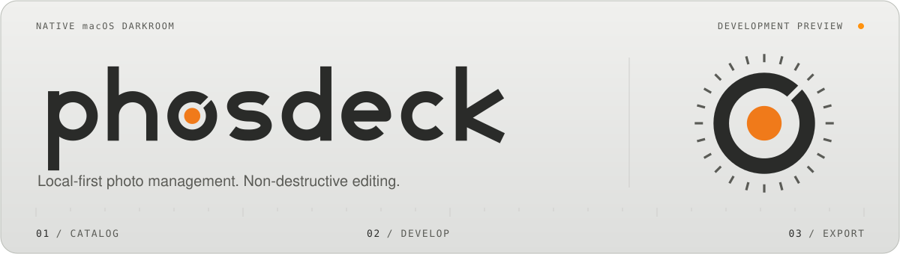

<picture>
  <source media="(prefers-color-scheme: dark)" srcset="docs/assets/readme/hero-graphite.svg">
  <source media="(prefers-color-scheme: light)" srcset="docs/assets/readme/hero-ivory.svg">
  
</picture>

<h1 align="center">Phosdeck</h1>

<p align="center">
  <a href="README.md">English</a> · <a href="README.zh.md">简体中文</a> · <a href="https://rankangkang.github.io/phosdeck/zh/">官网</a>
</p>

<p align="center">
  <a href="#快速上手"></a>
  <a href="#开发与贡献"></a>
  <a href="#支持范围与限制"></a>
  <a href="LICENSE"></a>
</p>

Phosdeck 是 macOS 上的照片管理与非破坏性编辑工具，使用 SwiftUI、Core Image、Metal 和 GRDB。照片保存在本地，整理信息和编辑参数存入图库，编辑不会覆盖原片。

项目目前处于开发预览阶段，可下载[预发布版本](https://github.com/rankangkang/phosdeck/releases)或从源码构建。

## 界面

<picture>
  <source media="(prefers-color-scheme: dark)" srcset="design/darkroom_workspace_graphite.jpg">
  <source media="(prefers-color-scheme: light)" srcset="design/darkroom_workspace_ivory.jpg">
  
</picture>

<p align="center"><sub>石墨与米白主题，随 GitHub 明暗外观切换。截图摄于 2026-11-03，画布使用合成测试图。</sub></p>

主题只影响界面，不改变照片像素或导出结果。

## 功能

| 功能 | 内容 |
|---|---|
| 照片整理 | 引用或复制导入，评级、标旗、颜色标签、关键词，普通／智能集合，虚拟副本、堆叠与 RAW/JPEG 关联 |
| 全局调整 | 曝光、白平衡、自由点曲线、HSL、黑白混色、点颜色、锐化、降噪、颗粒与暗角；预设、历史和快照 |
| 局部调整 | 画笔、线性／径向渐变、颜色／亮度范围蒙版，人物选择与污点修复 |
| 画面几何 | 裁剪、拉直、翻转与手动透视校正 |
| 导出 | JPEG、PNG、TIFF16，命名模板、导出预设、多规格输出与可选元数据；同名文件不覆盖 |

支持导入 Lightroom XMP 预设的部分全局参数，属于近似转换，不保证与 Lightroom 的渲染结果相同。Lightroom 图库不能直接打开。

## 快速上手

需要 macOS 26 或更新版本、Xcode 26 或更新版本（含 Metal Toolchain）。目前主要在 Apple Silicon 上验证。

仓库中 `site/` 以外的位图资源使用 [Git LFS](https://git-lfs.com/)。克隆前请安装 Git LFS 并运行 `git lfs install`；已有检出可安装后运行 `git lfs install` 和 `git lfs pull`。

1. 获取源码：

   ```sh
   git clone https://github.com/rankangkang/phosdeck.git phosdeck
   cd phosdeck
   ```

2. 在仓库根目录构建：

   ```sh
   xcodebuild -project Phosdeck.xcodeproj -scheme Phosdeck -configuration Debug -derivedDataPath build -destination 'platform=macOS' build
   ```

首次构建需要联网下载项目锁定的 Swift 包和二进制依赖。也可以在 Xcode 中打开 `Phosdeck.xcodeproj`，选择 `Phosdeck` scheme 并运行。

默认 Debug 构建使用本机临时签名，不需要 Apple 开发证书。实测 Xcode 27.1 的临时签名产物保留沙箱，但 hardened runtime 关闭；重新构建后可能需要重新授予文件访问权限。

构建产物位于 `build/Build/Products/Debug/Phosdeck.app`。首次使用可新建一个 `.phoscat` 测试图库，导入几张合成图片或有权使用的照片，试一下评级、编辑与导出。[上手指南](docs/getting-started.md)介绍了完整流程及备份恢复方法。

图库保存照片位置和调整，不包含原片。备份图库时，照片和导出文件需要另行备份。旧后缀 `.omlcat`／`.omlrcat` 仍可打开，是否在原位置更换后缀由打开时的提示确认；这不会转换数据库格式。

<details>
<summary>使用稳定的本机开发签名</summary>

如已在钥匙串中安装 Apple Development 证书，可新建 `Config/LocalSigning.xcconfig`，填写自己的团队 ID：

```xcconfig
CODE_SIGN_IDENTITY = Apple Development
DEVELOPMENT_TEAM = 你的团队ID
```

该文件已被 Git 忽略，会覆盖 Debug 的默认签名设置。上述构建流程用于本机开发，发行签名和公证需另行处理。

</details>

<details>
<summary>安装 Metal Toolchain</summary>

若 Xcode 报缺少该组件，可执行：

```sh
xcodebuild -downloadComponent MetalToolchain
```

</details>

## 支持范围与限制

| 项目 | 当前状态 |
|---|---|
| 输入 | JPEG、RGB 单页 TIFF、支持范围内的静态 PNG；ARW／NEF／CR3／RAF／部分 DNG 的实际可用性取决于机型、压缩方式与 macOS 解码能力。 |
| 暂未开放 | HEIC、Apple DNG／ProRAW。 |
| 输出 | JPEG、PNG8、TIFF16；当前固定为 sRGB，广色域与软打样尚未实现。 |
| 智能蒙版 | 整个人物选择使用系统 Vision，无需额外权重；对象与部位识别需要另行准备的研究模型。手动蒙版和已保存选区可在缺少模型时使用。人脸权重的分发授权尚待核实，详见[模型说明](docs/smart-mask-models.md)。 |
| 目录格式 | 开发阶段不保证旧版本目录兼容，不做旧 schema 迁移；升级前保留现有目录、备份与原片。 |
| 界面语言 | 内置简体中文和英文，支持社区语言包；英文界面仍有部分截断和文案问题，见[国际化说明](docs/localization.md)。 |

## 开发与贡献

在仓库根目录运行原生检查：

```sh
./scripts/check.sh
```

检查使用 `python3` 标准库准备可选的公开 RAW 测试素材，无需额外 Python 包。缺少样片、模型或相应授权环境时，部分测试会跳过；请按实际结果报告。

| 入口 | 内容 |
|---|---|
| [上手指南](docs/getting-started.md) | 创建图库、导入、编辑、导出及备份恢复 |
| [贡献与反馈](CONTRIBUTING.zh.md) · [English](CONTRIBUTING.md) | 问题反馈、开发检查和提交说明 |
| [开发约定](AGENTS.md) | 代码导航、数据保护、提交规范与本机体验流程 |
| [文档索引](docs/README.md) | 当前状态、已定决策与主题文档 |
| [设计规范 v3](design/darkroom_instrument_design_system_v3.md) | 原生暗房仪表外观与交互约定 |
| [设计 Token v3](design/darkroom_instrument_tokens_v3.json) | 米白／石墨配色、尺寸与状态 Token |
| [问题与建议](https://github.com/rankangkang/phosdeck/issues) | 提交复现步骤、运行环境或功能建议 |

## 致谢

Phosdeck 参考了 Lightroom Classic 的工作流，也使用了以下开源项目的算法和实现：

| 来源 | 借鉴与使用范围 |
|---|---|
| [Adobe Lightroom Classic](https://www.adobe.com/products/photoshop-lightroom-classic.html) | 照片管理、选片、显影、局部调整与批量输出的工作流参考。普通图像曝光响应表使用了合成图的 Lightroom 输出作为对照，公开使用依据仍待核对，见[已知问题](docs/STATUS.md#已知问题)。 |
| [Lightcraft](https://github.com/storytold/lightcraft) | 功能组织与交互参考；部分算法和实现按 MIT 许可移植、适配为 Swift／Metal，包括预设强度、蒙版、暗角、颗粒、点颜色和堆叠等。 |
| [PhotoCraft](https://github.com/storytold/photocraft) | 经 Lightcraft 引入的测试用 PatchMatch 原型来源，按 MIT 许可适配；该原型不属于当前 App 的修复管线。 |
| [Oklab — Björn Ottosson](https://bottosson.github.io/posts/oklab/) | 感知色彩处理使用其转换矩阵与参考实现，保留 MIT 许可及归属。 |

具体移植范围、上游版本和版权声明保存在[第三方归属与许可](docs/references/lightcraft-LICENSE.txt)中。

## 许可

本项目代码采用 [AGPL-3.0-only](LICENSE)。第三方代码、依赖和资源遵循各自许可，相关声明包括：

- [Lightcraft／PhotoCraft 的归属与 MIT 许可](docs/references/lightcraft-LICENSE.txt)。
- [Oklab 的归属与 MIT 许可](docs/references/oklab-LICENSE.txt)。
- [GRDB 的 MIT 许可](docs/references/grdb-LICENSE.txt)。
- [SmartMaskRuntime／LiteRT 的 Apache-2.0 许可](Packages/SmartMaskRuntime/LICENSE)与[固定运行时依赖声明](docs/references/litert-NOTICES.txt)。
- [智能蒙版研究模型的来源、许可及限制](docs/references/smart-mask-research-NOTICE.txt)。

模型权重和样片不随源码提供，其许可不由本项目的 AGPLv3 代替。模型版本、来源与打包限制见[智能蒙版说明](docs/smart-mask-models.md)。已移除的 Rust 实验所用声明保存在[历史归属档案](docs/references/legacy-rust/README.md)。
