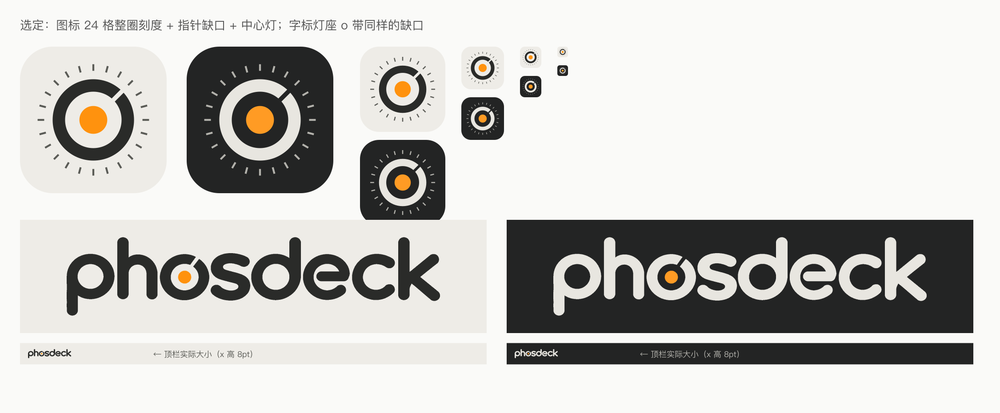

# Phosdeck · Logo

品牌名为 **Phosdeck**，字标写作小写 `phosdeck`。当前图标使用中心橙灯、右上指针缺口与 24 格等长刻度；字标沿用用户设计的圆角字形，保留灯环 `o` 的橙点与缺口。

应用图标在系统浅色与深色外观下均使用石墨底：

 

## 文件与生成

- `wordmark-original.svg` 是字标源文件；`wordmark-approved-<主题>.svg` 是 App 使用的主题资源，`logo-wordmark-<主题>.svg` 是同内容的导出。
- `logo-icon-<主题>.svg` 是当前图标的独立导出；`final.svg`／`final.png` 展示当前图标和字标。
- `Sources/App/AppIcon.icon` 是 App 的图标源文件，系统负责生成着色与透明外观。

在仓库根目录运行 `python3 design/logo/generate_logos.py`，可从字标源文件生成主题资源、图标和总览；PNG 生成需要本机的 `rsvg-convert` 与当前选中 Xcode 的 Icon Composer 工具。
